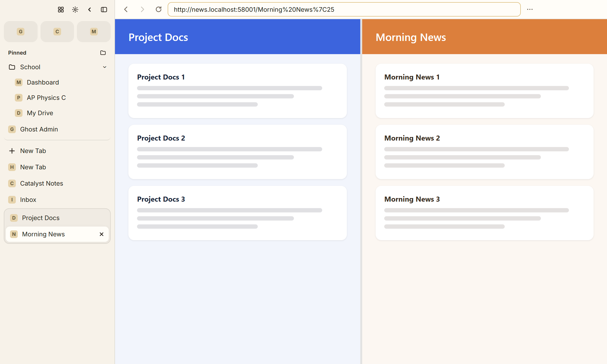
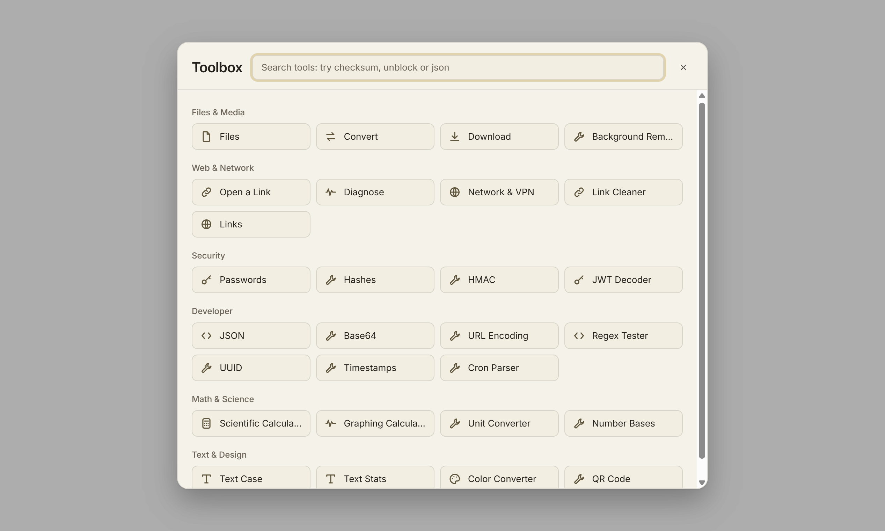
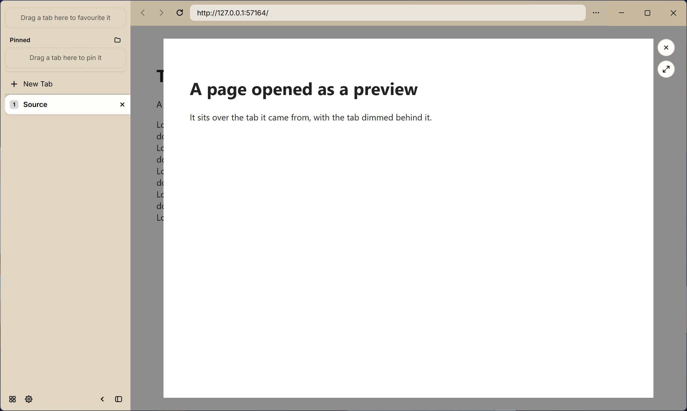

# Zing

A private browser for Windows, with your tabs down the side and the small tools you'd otherwise go looking for built in.

<picture>
	<source media="(prefers-color-scheme: dark)" srcset="docs/screenshots/phase4-split-2-dark.png">
	
</picture>

Zing runs on Chromium through Microsoft Edge's WebView2, so sites work as they do in Edge and Chrome, Google sign-in included. Out of the box it keeps nothing: close Zing and the sites you signed in to forget you. Anything that stores data, from restoring your tabs to the password vault, is a switch you turn on, and the privacy banner in Settings turns to a warning when one is on.

## What you get

- **Tabs down the side.** A tab rail on the left or right, or a classic bar along the top. Pin tabs, group them in folders, and keep the sites you open every day as favourites tiles above the rail.
- **Split view.** Up to four tabs side by side in one window.
- **Link previews.** A link to another site opens over the page you're reading, with that page dimmed behind it. Close it to carry on, or expand it into a tab.
- **Reader mode.** Strips a page down to the article.
- **Tracker blocking.** Refuses third-party requests to a list of common ad and analytics trackers, and strips tracking parameters from the links you open.
- **A password vault.** Unlocked with Windows Hello, and fills sign-in forms. Optional sync between your PCs is end-to-end encrypted: the sync server never sees a site, a username or a password (see [Privacy](#privacy)).
- **Bring your stuff.** Import bookmarks from Chrome, Edge, Brave, Dia and Arc on the same PC, and passwords from Chrome, Edge and Brave. Firefox, Safari and Mac browsers come in through a file you export from them.
- **A toolbox** of almost thirty tools, all running on your PC:
  - PDF tools: merge, split, reorder, turn and delete pages, add text, pictures and a signature, and fill forms
  - a file converter for images, documents, PDFs, audio and video, and a media downloader
  - a background remover for photos
  - QR codes, a link cleaner, a password generator, text case and text stats
  - JSON, regex, Base64, URL encoding, hashes, HMAC, JWT, UUID, timestamps and cron
  - a scientific calculator, a graphing calculator, units and number bases
- **Getting past blocks.** Open a Link tries other ways to reach a page your network won't load, Diagnose shows where a site is being blocked (DNS, the connection or the encryption handshake), and Network & VPN sets up encrypted DNS for the whole PC with one script.
- **Light on your PC.** The engine starts while the rest of Zing is still loading, which made a relaunch about 340 ms faster ([#206](https://github.com/wong04/zing/pull/206)). A tab you can't see drops from about 23 MB to about 9 MB at once, and to about 3 MB after five minutes ([#207](https://github.com/wong04/zing/pull/207)). Tabs you haven't looked at in 30 minutes go to sleep.
- **Colour.** Theme presets, or a whole theme from one colour you pick, in light and dark.

<picture>
	<source media="(prefers-color-scheme: dark)" srcset="docs/screenshots/phase-6/toolbox-dark.png">
	
</picture>

<picture>
	<source media="(prefers-color-scheme: dark)" srcset="docs/screenshots/link-preview/link-preview-dark.png">
	
</picture>

## Install

Zing runs on Windows 10 (version 2004 or later) and Windows 11.

Download `ZingBrowser-win-Setup.exe` from [Releases](https://github.com/wong04/zing/releases) and run it. It installs for your user only, with no admin prompt, and Zing updates itself from then on. The installer isn't code-signed yet, so Windows SmartScreen warns the first time: choose **More info**, then **Run anyway**.

On Windows 10, Zing needs Microsoft's WebView2 runtime, which most PCs already have through Edge.

## Privacy

Zing stores nothing until you turn something on. The password vault and its sync are both off by default, and the Settings privacy banner turns to a warning once the vault holds a login. The banner follows what is on this PC only, so turning on sync doesn't change it; this section is where sync's data leaving the PC is described.

If you turn on sync, your passwords go to a small Zing server (`server/`, run on Railway). You sign in to it with Google only, and the server accepts just the Google accounts on its allow-list.

- **What the server stores:** your Google account ID (the `sub`, not your email), a random ID of its own for you, your keys wrapped by your Zing password and your recovery key, your account name and email as ciphertext, and a sealed list of your logins. Per login it keeps an ID, a version number, a revision number, whether it is deleted, the encrypted data, and the time the server received the write. It also keeps a hash of each sign-in refresh token.
- **What it can't see:** site names, usernames, passwords, notes, password history and your edit times. They are encrypted on your PC (XChaCha20-Poly1305) with keys the server never gets, and sizes are padded to the next 256 bytes. Nothing derived from your Zing password is sent, so there is no hash to attack.
- **What it can see:** how many logins you have, when you sync, and your IP address, as any server does.
- **What Google sees:** each time you sign in to sync, Google sees that you signed in to Zing, as with any "Sign in with Google". It sees nothing of your passwords.
- **What it can do:** refuse or delay your data, or serve an older copy. Your PCs notice most of this and stop with an error instead of syncing. A few cases from a hostile server are accepted and listed in the [design](docs/superpowers/specs/2026-11-07-vault-sync-design.md). It can't read or change a password.
- **The one real risk:** someone who steals the server's data and guesses your Zing password offline. Turning on sync asks for a strong password (at least 12 characters, with a number and a symbol, and not a common one) and uses Argon2id with 256 MiB of memory to make that slow.

If you forget the password, the recovery key restores your vault. Without both, the passwords can't be recovered by anyone, including the server.

## Known limits

- **Mica.** Solid tab cards cover the window, so Windows' Mica material isn't visible behind Zing's sidebar.

## Building from source

Zing is a C# .NET 9 host (`host/`) that runs WebView2 for pages and a React and TypeScript UI (`src/renderer`), with shared logic in `src/shared`. It needs Node 24, the .NET 9 SDK and the WebView2 runtime.

```
npm ci
npm start
```

`npm test`, `npm run test:host` and `npm run test:e2e` run the TypeScript, C# and end-to-end tests; `npm run lint` and `npm run typecheck` check the code.

A build only has password sync when `ZingGoogleClientId` and `ZingGoogleClientSecret` (the Google Desktop OAuth client, see [server/README.md](server/README.md#google-oauth-client)) are set in the environment it builds in, as for `npm run build:host` or a Release build. Without them, Turn on sync says "Sync isn't set up in this build of Zing". With only one of them, the build refuses to start.

- [docs/PLAN.md](docs/PLAN.md): the plan, including the stack decision and tradeoffs
- [PARITY.md](PARITY.md): every feature, with its issue and status
- [docs/release.md](docs/release.md): cutting a release
- [CLAUDE.md](CLAUDE.md) and [AGENTS.md](AGENTS.md): working on Zing with coding agents

## License

[MIT](LICENSE).
